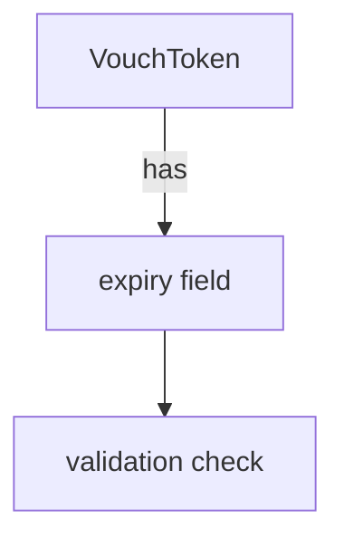
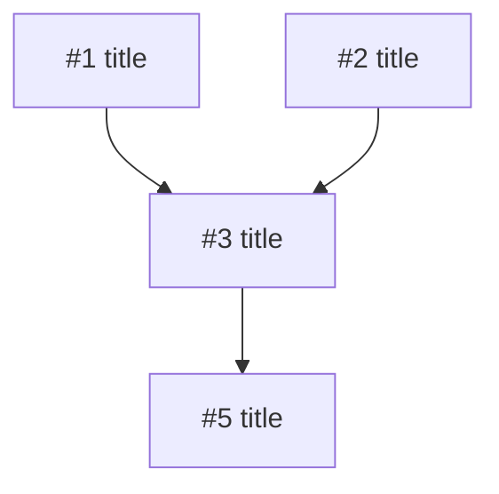

# Spec → Issues

Decompose a spec into GitHub issues with a dependency tree. Each issue becomes one PR later (via `/bp-implement-issues`).

## Input

The user provides a spec as one of:
- A file path (e.g., `incoming/feature-x.md`)
- A URL
- Inline text in the conversation
- A reference to a document already discussed

If ambiguous, ask which spec to use.

## Procedure

### 1. Understand the spec

Read the full spec. Identify:
- The goal / user-facing outcome
- Distinct functional pieces
- Technical constraints or risks
- Which repo(s) are affected (`chat`, `platform`, `toolbox`, `chat-frontend`)

### 2. Decompose into tickets

Split the spec into the **smallest independently-deliverable** units that:
- Can be implemented and reviewed in isolation
- Have a clear "done" definition
- Map to one PR each

**Splitting heuristics:**
- One module/component = one ticket (unless trivially small)
- Schema/migration changes separate from feature code that uses them
- Backend vs. frontend when they can land independently
- Test infrastructure (helpers, fixtures) separate if reused by multiple tickets
- Refactoring prerequisites separate from the feature that needs them

**Each ticket gets:**
- A concise title (`[repo] action: subject` — e.g., `[chat] add: VouchToken expiry field`)
- A body with:
  - **Context**: one sentence linking back to the spec/goal
  - **Scope**: what to implement (be specific — modules, functions, files)
  - **Acceptance criteria**: concrete checkable items
  - **Out of scope**: what NOT to do (prevents scope creep)
  - **Depends on**: `#<issue-number>` references (added after creation, see step 3)

### 3. Build the dependency tree

Classify each ticket's relationship to others:

- **Independent** — can start immediately, no prerequisites
- **Depends on X** — needs X merged first (schema before feature, lib before consumer)

Arrange into layers:
```
Layer 0 (no deps):  #10, #11, #12     ← can all start in parallel
Layer 1 (deps L0):  #13 → #10, #14 → #11
Layer 2 (deps L1):  #15 → #13, #14
```

### 4. Create diagrams

For each ticket (and for the overall plan), create diagrams that show **what changes and how it connects**. GitHub renders Mermaid natively in issue bodies.

**What to diagram (pick what fits each ticket):**
- **Data flow** — how data moves through new/modified modules
- **Schema changes** — new tables, fields, relations (ER diagram)
- **Component tree** — LiveView/LiveComponent hierarchy changes
- **Sequence** — interaction between processes, services, or user ↔ system
- **State machine** — if the ticket introduces state transitions
- **Before/after** — side-by-side showing what the change replaces

**Per-ticket**: include 1-2 diagrams in the issue body that make the scope visually unambiguous. Focus on the boundaries — what this ticket touches vs. what it doesn't.

**Overall plan**: include a dependency graph in the plan review (step 5) showing all tickets and their relationships.

Use Mermaid fenced blocks in issue bodies:
````markdown

````

Keep diagrams compact — they clarify scope, not replace the text description.

### 5. Present the plan for review

Before creating any issues, present the decomposition to the user:

```markdown
## Spec: <title>

### Dependency graph


### Tickets (<count>)
1. **<title>** — <one-line scope> [independent]
   > diagram: <brief description of what the per-ticket diagram will show>
2. **<title>** — <one-line scope> [depends on: 1]
   > diagram: <brief description>
...
```

Ask the user to confirm, adjust grouping, or re-split before proceeding.

### 6. Create issues on GitHub

All issues go to `Buckitup-chat/chat` (per project convention). Use `platform` label for platform-only tickets.

Create in dependency order (Layer 0 first) so that `Depends on: #N` references are available for later layers.

```bash
gh issue create -R Buckitup-chat/chat \
  --title "<title>" \
  --label "<labels>" \
  --body "$(cat <<'EOF'
## Context
<link to spec or one-sentence summary>

## Overview
```mermaid
<diagram showing what this ticket changes — data flow, schema, component tree, sequence, or before/after>
```

## Scope
<what to implement>

## Acceptance criteria
- [ ] criterion 1
- [ ] criterion 2

## Out of scope
- <what not to do>

## Dependencies
Depends on: <none | #N, #M>
Blocked by: <none | list>
EOF
)"
```

**Labels to apply:**
- `spec:<spec-slug>` — groups all issues from this spec (create label if needed)
- `layer:0` / `layer:1` / `layer:2` — implementation order
- `platform` — if the ticket is platform-specific
- `ready` — for Layer 0 tickets (no blockers, awaiting user review)
- `blocked` — for tickets with unmerged dependencies

> **Note:** Do NOT add the `go` label. The user reviews each issue and adds `go` manually to approve it for implementation. `/bp-implement-issues` only picks up issues that have both `ready` and `go`.

### 7. Cross-reference

After all issues are created:
1. Update each issue's "Dependencies" section with actual issue numbers
2. Add `Blocked by #X` lines so they're visible in the issue list
3. Comment on each Layer 0 issue: `Ready to implement. Part of spec: <spec-name>`

### 8. Output summary

Print the final tree with issue numbers and links:

```
Spec: <name> — <N> issues created

Layer 0 (ready — add `go` label to approve for implementation):
  #101 [chat] add: VouchToken expiry field
  #102 [chat] add: expiry check in vouch validation

Layer 1 (blocked):
  #103 [chat] add: expiry UI in vouch dialog → depends on #101
  #104 [platform] add: expiry sync handling → depends on #101

Layer 2 (blocked):
  #105 [chat] add: auto-renewal flow → depends on #103, #104
```

Remind the user: review each issue and add the `go` label when satisfied with scope and criteria.

## Notes

- Keep tickets focused. If explaining the scope takes more than a paragraph, the ticket is too big — split further.
- Prefer many small tickets over few large ones. Small PRs review faster.
- The user reviews this decomposition before issues are created. Don't rush to `gh issue create`.
- If the spec is vague on a point, flag it as a question in the plan rather than guessing.
